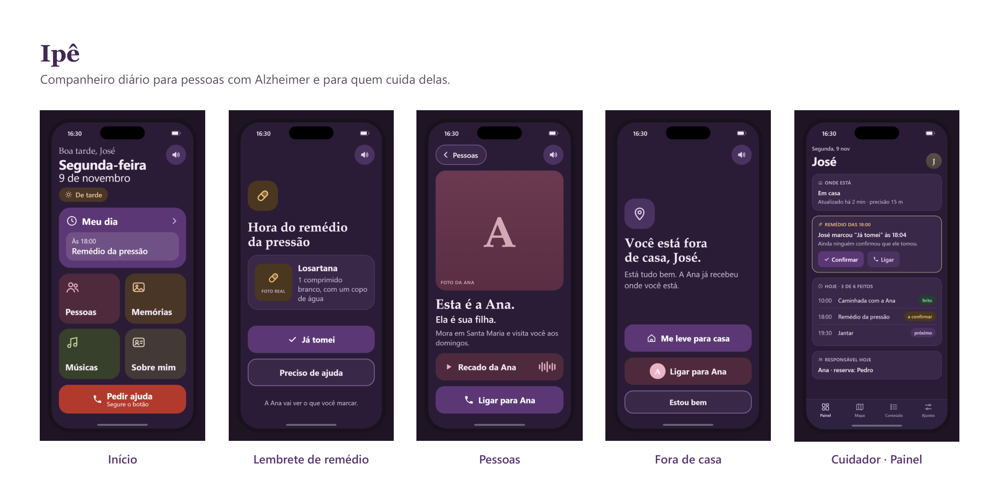

# Ipê

**A daily companion for people living with Alzheimer's, and for the families who care for them.**

## The problem

Brazil has about 2.4 million people living with dementia. In the early and moderate stages of Alzheimer's, a person loses track of the day, forgets medication, stops recognizing faces and can get lost on the street. Their families carry constant worry: many family caregivers say they don't feel prepared, and they call every hour just to check.

## What Ipê does

Ipê turns a phone into a calm guide for the patient and a quiet safety net for the family.

**For the patient**
- Today at a glance: the day, the date, the part of the day and what comes next.
- Medication reminders with a simple "I've taken it".
- The people in their life, with photos, names and voice messages recorded by the family.
- Memories, music from their life and an "About me" card for when they are lost.
- A help button, and a screen that appears by itself when they leave home and shows the way back.

**For the family**
- Medication, location and requests for help, live, on one dashboard.
- A map with a safe zone around home.
- Control over what the patient sees, as the disease changes.

| | | | |
|---|---|---|---|
|  |  |  |  |
| Today at a glance | Family, with their own voices | Away from home, the way back | Caregiver map and safe zone |

## Designed for the person using it

Ipê follows cognitive accessibility guidelines (W3C COGA) and WCAG 2.2 contrast: large text and buttons, simple taps, a calm night theme, and language that reassures without ever testing memory. Health data is sensitive under Brazil's LGPD, so privacy is part of the design from the start.

## What's next

Multiple caregivers per patient, push alerts, an Apple Watch companion with fall detection, and a pilot with families and a care home.

## About

Created by Yussef Omar Hallak at the HackaTruck MakerSpace. iOS app in Swift and SwiftUI, with a cloud backend on IBM Cloud.

The source code is private. Reviewers, hiring teams and partners can request access at yussefomarh@gmail.com.
