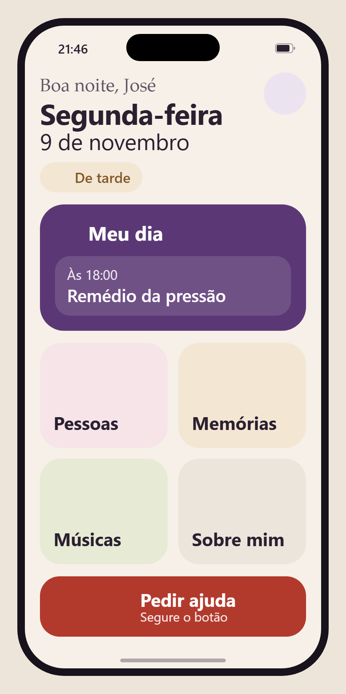
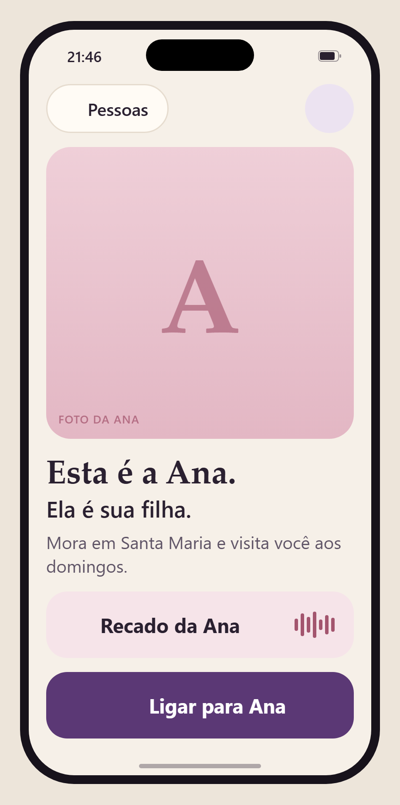
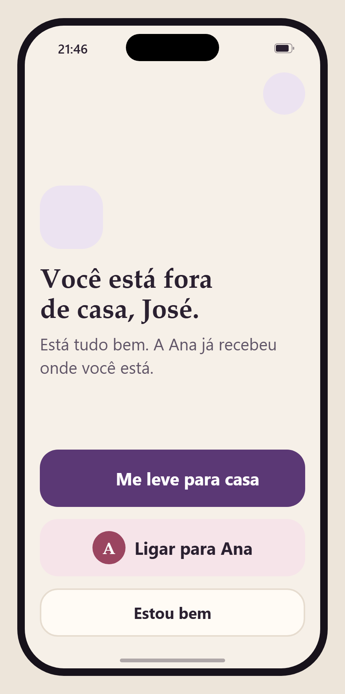
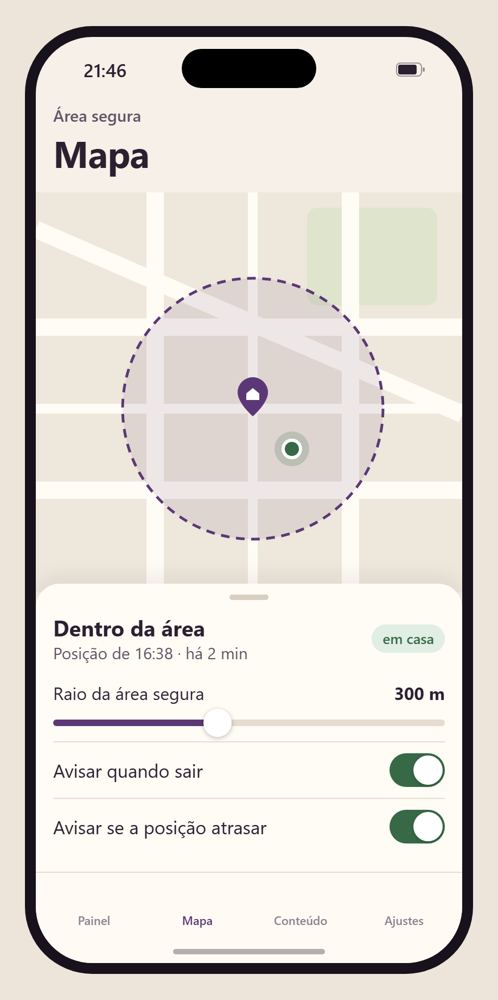

# Ipê

**A daily companion for people living with Alzheimer's, and for the families who care for them.**

In the early and moderate stages of Alzheimer's, people lose track of the day, forget medication, stop recognizing faces and can get lost on the street. Their families live with constant worry and call every hour just to check.

Ipê turns a phone into a calm guide for the patient and a quiet safety net for the family. The patient sees what day it is, what comes next, who the people in their life are and how to get home, in large, simple screens that inform without ever testing memory. The caregiver follows medication, location and requests for help in real time, and decides what the patient sees.

| | | | |
|---|---|---|---|
|  |  |  |  |
| Today at a glance | Family, with their own voices | Away from home, the way back | Caregiver map and safe zone |

**Designed for accessibility from the start.** Ipê follows cognitive accessibility guidelines (W3C COGA) and WCAG 2.2 contrast, with large text, simple taps, a calm night theme and privacy built around Brazil's LGPD.

**Built with** Swift and SwiftUI on iOS, with a cloud backend on IBM Cloud.

Created by Yussef Omar Hallak at the HackaTruck MakerSpace. The source code is private.
